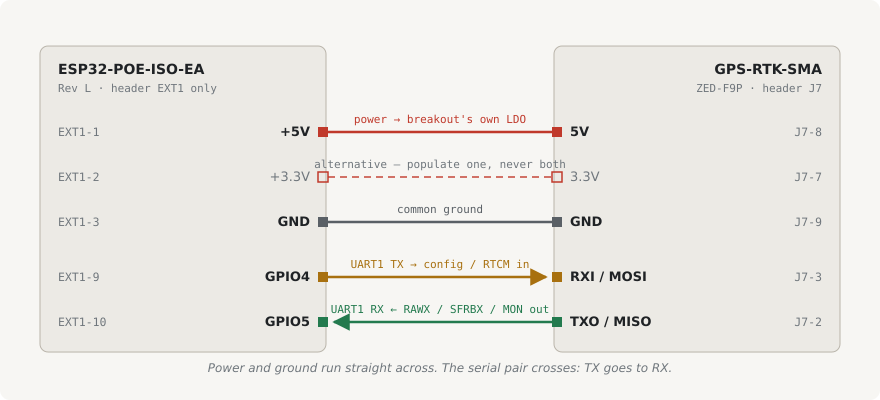

# gnss-bridge -- the attic ZED-F9P's link to the network

An Olimex **ESP32-POE-ISO-EA (Rev L)** that moves bytes between the receiver's UART1 and one
TCP client. It holds no GNSS logic: RTCM generation, the base coordinate and the caster all
live in [`tanka/environments/ntrip/`](../../tanka/environments/ntrip/README.md), where
`str2str` builds the RTCM MSM messages from the receiver's raw observations.

```
ZED-F9P --UART1 460800--> ESP32-POE-ISO --TCP 6638--> str2str_tcp --> 127.0.0.1:5015
  (SparkFun GPS-RTK-SMA)      (PoE, attic)             (any worker)      |
                                                                         +--> NTRIP caster :2101
```

The receiver is on a UART rather than its USB port because the ESP32 has no USB host. Its USB
port keeps its own independent `CFG-MSGOUT` configuration, untouched, so a USB cable into any
machine is a working fallback.

## Status

**The board is flashed and on the network. The harness is not built.**

| | |
|---|---|
| ESP32 flashed, PoE, link up | yes -- `gnss-bridge`, **10.0.4.196** |
| `stream_server` listening on 6638 | yes -- accepts a connection, 0 bytes with no UART attached |
| ESPHome API on 6053 | yes -- discovered and adopted by Home Assistant |
| Harness soldered and crimped | **no** |
| Receiver reconfigured for UART1 | **no** -- still USB-only, `CFG-MSGOUT-*_USB` |
| `settings.conf` pointing at the bridge | yes, merged in #813 -- takes effect when the prod tag moves |

So the Ethernet, PoE and TCP-listener half is confirmed on real hardware; everything
downstream of the UART pins is not. Pin assignments below come from the two vendors'
schematics, not from a working link.

`10.0.4.196` is a DHCP lease. `settings.conf` resolves `gnss-bridge.local.symmatree.com` at
startup, so that name wants a reservation before the cutover.

## Wiring



| Wire | ESP32-POE-ISO | Pin | GPS-RTK-SMA | Pin |
|---|---|---|---|---|
| red | `+5V` | EXT1-1 | `5V` | J7-8 |
| black | `GND` | EXT1-3 | `GND` | J7-9 |
| yellow | `GPIO4` (UART1 TX) | EXT1-9 | `RXI/MOSI` | J7-3 |
| green | `GPIO5` (UART1 RX) | EXT1-10 | `TXO/MISO` | J7-2 |

All four land on **EXT1**. The ESP32 routes UART through its GPIO matrix, so the pin choice is
config ([`gnss-bridge.yaml`](gnss-bridge.yaml)), not a constraint: GPIO32/33 (EXT2 pins 6 and
5) are the fallback if these two misbehave with Ethernet up.

The breakout's `DSEL` jumper selects SPI when closed, which disables UART1. It ships open.

### Pinout: ESP32-POE-ISO Rev L

Harness pins in **bold**. Transcribed from the Rev L KiCad netlist
([OLIMEX/ESP32-POE-ISO](https://github.com/OLIMEX/ESP32-POE-ISO)); pull-ups from the board's
pinout sheet. `GPI34`-`GPI39` are input-only, an ESP32 limitation, not a board one.

**EXT1** (1x10) -- the only header with power on it:

| Pin | Signal | Notes |
|---|---|---|
| **1** | **`+5V`** | **harness: power.** Output only when on USB or PoE; 0.4 A / 2 W |
| 2 | `+3V3` | also UEXT-1. Output only, 0.3 A / 1 W |
| **3** | **`GND`** | **harness: ground** |
| 4 | `ESP_EN` | reset, tied to RST1 |
| 5 | `GPIO0` | strapping (boot mode); free after programming |
| 6 | `GPIO1` | `U0TXD` -- USB-serial console |
| 7 | `GPIO2` | strapping; SD-card `HS2_DATA0`; 2.2k pull-up; also UEXT-8 |
| 8 | `GPIO3` | `U0RXD` -- USB-serial console |
| **9** | **`GPIO4`** | **harness: UART1 TX.** Also UEXT-3 |
| **10** | **`GPIO5`** | **harness: UART1 RX.** Strapping (SDIO timing, unused); 10k pull-up; also UEXT-10 |

**EXT2** (1x10) -- no power pins:

| Pin | Signal | Notes |
|---|---|---|
| 1 | `GPI39` | input only; external-supply sense |
| 2 | `GPI36` | input only; 2.2k pull-up; reaches UEXT-4 through `D4` |
| 3 | `GPI35` | input only; LiPo voltage sense if `SENS_BAT_E1` is closed |
| 4 | `GPI34` | input only; user button BUT1; 10k pull-up |
| 5 | `GPIO33` | free -- UART fallback |
| 6 | `GPIO32` | free -- UART fallback |
| 7 | `GPIO16` | I2C SCL; 2.2k pull-up; also UEXT-5 |
| 8 | `GPIO15` | SD-card `HS2_CMD`; strapping; 10k pull-up; also UEXT-7 |
| 9 | `GPIO14` | SD-card `HS2_CLK`; also UEXT-9 |
| 10 | `GPIO13` | I2C SDA; 2.2k pull-up; also UEXT-6 |

**UEXT** (2x5 boxed) -- every pin is shared with EXT1/EXT2, so do not use the same GPIO on
both connectors:

| Pin | Signal | | Pin | Signal |
|---|---|---|---|---|
| 1 | `+3V3` | | 2 | `GND` |
| 3 | `GPIO4` | | 4 | `GPI36` **through `D4`, a series 1N5819** |
| 5 | `GPIO16` SCL | | 6 | `GPIO13` SDA |
| 7 | `GPIO15` | | 8 | `GPIO2` |
| 9 | `GPIO14` | | 10 | `GPIO5` |

**Consumed by Ethernet, not on any header:** `GPIO12` PHY power, `GPIO17` EMAC clock out,
`GPIO18` MDIO, `GPIO23` MDC, and the fixed RMII pins `GPIO19`, `GPIO21`, `GPIO22`, `GPIO25`,
`GPIO26`, `GPIO27`. On WROVER variants `GPIO16`/`GPIO17` go to PSRAM and the Ethernet clock
moves to `GPIO0` -- this board is a WROOM-32UE, so it does not.

### Pinout: SparkFun GPS-RTK-SMA (ZED-F9P)

Header **J7**, 1x9. From the Eagle schematic in
[sparkfun/Qwiic_GPS-RTK2](https://github.com/sparkfun/Qwiic_GPS-RTK2). Silkscreen labels carry
both names because the pins are shared between UART1/I2C and SPI; `DSEL` open (the default)
selects UART1 + I2C, closed selects SPI.

| Pin | Signal | Notes |
|---|---|---|
| 1 | `SCL/SCK` | I2C clock, or SPI clock |
| **2** | **`TXO/MISO`** | **harness: receiver TX out** -> ESP32 `GPIO5` |
| **3** | **`RXI/MOSI`** | **harness: receiver RX in** <- ESP32 `GPIO4` |
| 4 | `SDA/CS` | I2C data, or SPI chip select |
| 5 | `RX2` | UART2 in -- the F9P's dedicated RTCM correction input |
| 6 | `TX2` | UART2 out |
| 7 | `3.3V` | regulated rail; feeding here bypasses the onboard AP2112 |
| **8** | **`5V`** | **harness: power.** Into the onboard AP2112 |
| **9** | **`GND`** | **harness: ground** |

Pin order differs between the two boards: EXT1 1-2-3 is +5V, +3.3V, GND; J7 7-8-9 is 3.3V, 5V,
GND.

Also on the board, not on J7: two Qwiic connectors (same I2C as pins 1 and 4), USB-C (its own
independent `CFG-MSGOUT` configuration, which is the fallback path), and the SMA for the
antenna, whose LNA is fed through a bias tee off the 3.3V rail.

### Why EXT1 and not UEXT

GPIO4 and GPIO5 are on both EXT1 (pins 9, 10) and UEXT (pins 3, 10), and UEXT also carries
`GPIO13`/`GPIO16` for the sensor -- but it brings out only +3.3V, and the 5V route is the
better supply ([Power](#power)). UEXT's IDC would also save no work here: J7 at the other end
is a 1x9 single row, so that end is discrete contacts either way.

One UEXT fact worth recording in case it is ever revisited: pin 4 reaches `GPIO36` through
`D4`, a series 1N5819, making that line pull-up dependent rather than push-pull. Every other
UEXT pin is a direct connection.

### Antenna

The `-EA` carries a **WROOM-32UE**, which has no PCB antenna -- the U.FL is the only RF path.
**Fit the pigtail and bulkhead**, even though this config never transmits.

That is a property of the current config, not of the box. Stock images for this class bring up
a provisioning AP by default, and anything flashed here over the next several years -- a
recovery image, a debug build, an agent that does not know the RF port is open -- would
transmit into an unterminated connector. A connected antenna makes that a non-event forever,
and it has to happen while the board is on the bench rather than mounted in the attic.

### Pins to solder

Olimex ships the board without headers. All three are 0.1 in / 2.54 mm.

| Board | Header | Strip | Used |
|---|---|---|---|
| ESP32-POE-ISO | EXT1 | 1x10 | 1 (or 2), 3, 9, 10 |
| GPS-RTK-SMA | J7 | 1x9 | 2, 3, 7 or 8, 9 |

A 1x10 housing covers the ESP32 end with positions 1, 3, 9 and 10 populated; a 1x9 covers the
breakout end.

## Power

The breakout brings out **3.3V and 5V on adjacent pins** (J7-7, J7-8) and carries an AP2112
good for 600 mA from a 5V input. So the only question is which Olimex rail feeds it.

**Feed 5V (EXT1-1 -> J7-8).** The breakout's own LDO regulates it down, so the receiver sees a
linear supply -- what u-blox asks for, and what SparkFun means by wanting under 50 mV ripple on
a direct 3.3V feed "for precision locating". No added part, and more headroom than the
alternative.

Load is about **180 mA**: the ZED-F9P at 68-130 mA depending on acquisition, plus up to 48 mA
for the SPK6618H's LNA through the SMA bias tee. A BLE radio added later averages tens of mA,
well inside what is left; WiFi, which peaks near 250 mA, is the one that would need rechecking. Per the Rev L pinout sheet the +5V pin
sources up to **0.4 A (2 W)**, and that total covers anything drawn through +3.3V as well;
+3.3V has its own **0.3 A (1 W)** sub-limit.

| Supply route | Draw | Against its rating |
|---|---|---|
| **5V in** (EXT1-1 -> J7-8) | 180 mA, 0.9 W | 45% of 0.4 A; 45% of the 2 W total |
| 3.3V in (EXT1-2 -> J7-7) | 180 mA, 0.59 W | 60% of 0.3 A; 59% of the 1 W sub-limit |

Feeding 3.3V bypasses the AP2112 and runs the receiver off the Olimex's SY8089 buck -- less
total draw and less heat, but a switching rail into a receiver that wants a quiet one.
`UBX-MON-RF` (`noisePerMS`, `agcCnt`, CN0) measures whether that costs anything.

(The older ESP32-POE user manual gives 1 W rather than 2 W for the ISO variant. The Rev L
pinout sheet is ISO-specific and matches the `F0505S-2WR2` fitted on the board, so these
figures follow the sheet.)

## Temperature

`ESP32-POE-ISO-EA` is the commercial grade part, **0-70 C**; `-IND` is -40/+85. The other
parts in the chain are wider or equal: the `F0505S-2WR2` is -40/+105 and holds full 2 W to
+85 C, the ZED-F9P is -40/+85, and the SPK6618H antenna is -45/+70.

**The attic's ambient range is not known**, and nothing here measures it. acebase exposed only
a CPU die sensor and a static `acpitz` value, so the temperature series in
[`docs/bare-metal-nodes.md`](../../docs/bare-metal-nodes.md) is a proxy taken on a part with
its own heat. Nearest thing to evidence: the antenna carries the same +70 C ceiling and has
been up there since about May 2023. GPIO13/GPIO16 are free on EXT2 with 2.2k pull-ups already
fitted, if an I2C part is ever wanted.

## Flashing

[`gnss-bridge.yaml`](gnss-bridge.yaml) is an ESPHome config, not an image -- it has to be
compiled before it can be written, and `web.esphome.io` only flashes an already-built `.bin`.

**Via the Home Assistant ESPHome add-on**, which is where these are managed: copy the file into
the add-on's config directory, and it appears in the dashboard. First flash is **Install ->
Plug into this computer** with the board on USB; the board's USB-serial is a CH340, so it shows
up as `/dev/ttyUSB0`. After that it is OTA from the same dashboard, and the `api:` block is
what lets Home Assistant discover and adopt it.

That config directory is the copy the add-on builds from, so this file is the source and the
add-on's copy is a deployment of it. Changes made in the dashboard do not come back here.

Without the add-on, the same thing from a checkout:

```bash
esphome run firmware/gnss-bridge/gnss-bridge.yaml
esphome logs firmware/gnss-bridge/gnss-bridge.yaml
```

Either way the first build fetches the `stream_server` external component from GitHub, so it
needs network. Serial logs come out over USB before the network is up; after that they are
over the API.

USB and PoE at the same time are safe on the **ISO** variant -- that is what the isolation is
for -- so the board can stay on Ethernet while you flash it.

## Cutover

Done:

1. ~~Flash the board, confirm it pulls a DHCP lease over PoE.~~ Done -- `10.0.4.196`,
   listening on 6638, adopted by Home Assistant.

Remaining, in order:

2. Reserve `gnss-bridge.local.symmatree.com` for the board, since `settings.conf` resolves
   that name and `10.0.4.196` is currently a lease.
3. **Export the receiver's config over USB, before touching it**, and commit the result:
   `./receiver-config.py export --serial /dev/ttyACM0 > receiver-config.txt`. It is the only
   record of what is in that receiver's flash, and the revert path
   ([#704](https://github.com/symmatree/tiles/issues/704)).
4. Solder the headers, crimp the harness, connect it ([Wiring](#wiring)).
5. `./receiver-config.py apply --serial /dev/ttyACM0` -- UART1 to 460800 and the message set,
   to RAM and Flash. Not BBR: the breakout has no battery backup. Nothing in the apply touches
   the USB port's own configuration, so USB stays a working fallback.
6. Confirm the bridge is carrying the receiver:
   `nc gnss-bridge.local.symmatree.com 6638 | xxd | head` should show UBX frames starting
   `b5 62`. Everything downstream of that is TCP.
7. Move the prod tag. `str2str_tcp` dials the bridge; watch `MON-COMMS` `txPeakUsage` and
   `overrunErrs` for UART headroom, and `MON-RF` `noisePerMS` / `agcCnt` / `antStatus` for the
   antenna feed and whether the supply choice costs anything.

`MON-COMMS` and `MON-RF` are the diagnostics this receiver has. `MON-SYS` -- CPU load, memory,
die temperature -- is not available: the ZED-F9P Interface Description (UBX protocol 27.10)
never mentions it, and it first appears in the F9 HPS line at protocol 33.40. This firmware is
HPG 1.32, protocol 27.31.

**Nothing downstream moves until step 7.** The image rewrites `str2str_tcp` to dial the bridge
instead of opening a serial device, so a pod restart after that tag move needs the bridge
answering. Until then the merged change does not affect what is running.

## When the link is down, corrections stop

Nothing buffers, and nothing should: RTCM is only useful time-aligned with the rover's own
observations, so a correction held for later is worthless by the time it is delivered. The
bridge discards UART bytes while no client is connected, which is the correct behaviour rather
than a limitation.

What a restart costs is therefore availability, not a record. While the pod is down -- a config
change, an image update, an eviction -- the caster is not serving, and a rover ages out of RTK
Fixed through Float to an uncorrected 3D fix. How the vehicle responds to that is a flight
stack question, not one this repo answers.

Two consequences worth keeping in view:

- **Land config changes between flights.** `strategy: Recreate` means a full stop and start.
- **One persistent client on the bridge.** The stream server fans one UART through a single
  shared ring buffer and drops a slow client's pending bytes, so a second long-lived reader is
  a way to lose receiver data. Anything else that wants the stream connects to rtkbase's
  `127.0.0.1:5015` relay, which is what the relay is for -- and which runs `str2str -b 1`, so
  writes there reach the receiver's UART through the bridge.
